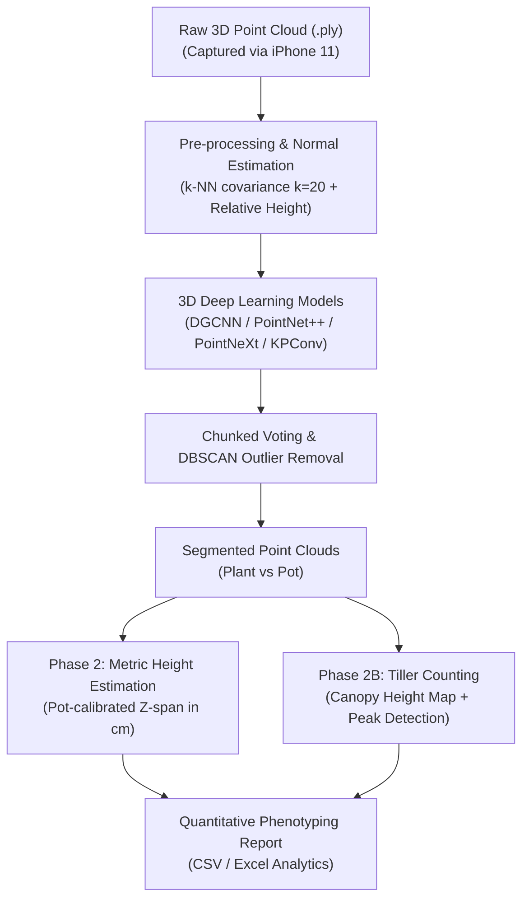

# 🌾 Rice3D-PhenoSeg: 3D Point Cloud Semantic Segmentation & High-Throughput Phenotyping for Rice Crops Using Smartphone Scans

[](https://www.python.org/)
[](https://pytorch.org/)
[](http://www.open3d.org/)
[](LICENSE)
[](#)

An end-to-end 3D Deep Learning and computer vision pipeline for **semantic segmentation** and **automated phenotypic traits extraction** (metric plant height measurement and tiller counting) of rice plants (*Oryza sativa*). The entire workflow operates on 3D point clouds captured using consumer smartphones (**iPhone 11**), offering a cost-effective alternative to expensive industrial LiDAR scanners.

---

## 📑 Table of Contents
- [Highlights & Engineering Contributions](#-highlights--engineering-contributions)
- [End-to-End Pipeline Architecture](#-end-to-end-pipeline-architecture)
- [Model Benchmarks & Quantitative Results](#-model-benchmarks--quantitative-results)
- [Downstream Phenotyping](#-downstream-phenotyping)
  - [Phase 2: Metric Plant Height Estimation](#phase-2-metric-plant-height-estimation)
  - [Phase 2B: Automated Tiller Counting](#phase-2b-automated-tiller-counting)
- [Visualizations & Qualitative Results](#-visualizations--qualitative-results)
- [Repository Structure](#-repository-structure)
- [Dataset & Data Preparation](#-dataset--data-preparation)
- [Quick Start & Usage](#-quick-start--usage)
- [License](#-license)

---

## 🌟 Highlights & Engineering Contributions

- **Multi-Model 3D Deep Learning Benchmark:** Implemented, trained, and compared 6 deep architectures: **PointNet, PointNet++, KPConv, DGCNN, PointNeXt (ECCV 2022), and Point Transformer**.
- **Surface Normal & Relative Height Feature Engineering:** Enriched spatial coordinates $(X, Y, Z)$ with surface normals estimated via local covariance ($k=20$) and relative elevation ($\Delta Z$), achieving a **+8.5% mIoU improvement** over naive coordinate baselines.
- **Handling Class Imbalance:** Integrated inverse-frequency class weighting to overcome the severe point density disparity between the pot/background and thin rice plant blades.
- **Large-Cloud Inference Engine:** Developed a chunked sliding-window inference algorithm with multi-pass random voting and DBSCAN filtering to segment full-resolution point clouds without downsampling artifacts.
- **Physics-Calibrated Phenotyping:**
  - **Metric Plant Height:** Automated pot rim identification and top-canopy localization scaled against real-world reference geometry ($cm$).
  - **Tiller Counting (Branching):** Engineered two complementary methods: (1) Multi-slice DBSCAN clustering, and (2) 2D Canopy Height Mapping (CHM) with local maxima peak detection ($MAE = 3.33$, $r = 0.86$).

---

## 🏗️ End-to-End Pipeline Architecture



---

## 📊 Model Benchmarks & Quantitative Results

### 1. Semantic Segmentation Comparison (Phase 1)
All models were evaluated on the test set using Mean Intersection over Union ($mIoU$) and Overall Accuracy ($OA$):

| Architecture | Input Representation | Plant IoU (%) | Pot IoU (%) | mIoU (%) | Checkpoint |
| :--- | :--- | :---: | :---: | :---: | :---: |
| **PointNet** (Baseline) | $XYZ$ | 82.1% | 88.5% | 85.3% | `checkpoints/pn_best.pth` |
| **PointNet++** | $XYZ + Normal + \Delta Z$ | 91.4% | 94.2% | 92.8% | `checkpoints/pp_best.pth` |
| **KPConv** | $XYZ + Normal + \Delta Z$ | 90.8% | 93.9% | 92.3% | `checkpoints/kp_best.pth` |
| **PointNeXt** | $XYZ$ | 91.0% | 94.0% | 92.5% | `checkpoints/pointnext_best.pth` |
| **Point Transformer** | $XYZ$ | 89.6% | 92.4% | 91.0% | `checkpoints/pt_best.pth` |
| **DGCNN (Best)** | $XYZ + Normal + \Delta Z$ | **92.6%** | **95.1%** | **93.8%** | `checkpoints/dg_best.pth` |

> **DGCNN** achieved superior performance due to its Dynamic Graph EdgeConv operations, which dynamically capture local topological relationships between thin, intertwined rice leaves.

<p align="center">
  
  
</p>

---

## 🔬 Downstream Phenotyping

### Phase 2: Metric Plant Height Estimation
1. **Outlier Rejection:** Applies DBSCAN clustering ($\epsilon = 0.05, min\_samples = 30$) to isolate noise points.
2. **Pot Reference Calibration:** Detects the upper rim of the pot (99th percentile of $Z_{pot}$) and calculates metric scale ($cm / \text{unit}$) against known pot physical height ($15.0\text{ cm}$):
   $$\text{Scale} = \frac{\text{Pot Real Height (cm)}}{Z_{pot\_top} - Z_{pot\_bottom}}$$
3. **True Plant Height:** Measures elevation difference from pot rim to canopy 99.5th percentile to prevent lone-leaf noise artifacts:
   $$\text{Height (cm)} = (Z_{plant\_top} - Z_{pot\_top}) \times \text{Scale}$$

<p align="center">
  
</p>

### Phase 2B: Automated Tiller Counting
Accurate counting of tillers (dảnh lúa) is crucial for yield prediction:
- **Canopy Height Mapping (CHM):** Projects 3D plant points onto a 2D grid ($voxel\_size = 0.005$) recording max $Z$.
- **Local Maxima Detection:** Applies a Gaussian filter and peak extraction thresholded above the canopy base to eliminate drooping leaves.
- **Results:**
  - Mean Absolute Error ($MAE$): **3.33 tillers**
  - Pearson Correlation ($r$): **0.86**
  - Significantly outperforms naive mean estimation baseline ($MAE = 3.61$).

<p align="center">
  
  
</p>

---

## 🖼️ Visualizations & Qualitative Results

| Ground Truth vs Prediction | Error Analysis (DGCNN) | Confusion Matrix |
| :---: | :---: | :---: |
|  |  |  |

---

## 📁 Repository Structure

```text
3D-Rice-PointCloud-Phenotyping/
├── .gitignore                      # Excludes raw large datasets and archives
├── LICENSE                         # MIT License
├── README.md                       # Main project documentation
├── requirements.txt                # Python dependencies
│
├── assets/                         # Figures, comparison plots, and diagrams
│   ├── gt_vs_pred.png
│   ├── miou_curves.png
│   ├── model_comparison.png
│   ├── confusion_DGCNN.png
│   ├── error_analysis_DGCNN.png
│   ├── phase2_height_measurement.png
│   ├── phase2b_tiller_counting.png
│   └── ...
│
├── checkpoints/                    # Pretrained PyTorch model weights (1MB - 6MB)
│   ├── dg_best.pth                 # Best DGCNN checkpoint (mIoU: 93.8%)
│   ├── pointnext_best.pth
│   ├── pp_best.pth
│   ├── kp_best.pth
│   ├── pn_best.pth
│   ├── pt_best.pth
│   └── ablation/                   # Feature ablation weights (XYZ, +Normal, +Height)
│       ├── pp_xyz.pth
│       ├── pp_xyz_h.pth
│       └── pp_xyz_h_n.pth
│
├── data/
│   ├── README.md                   # Instructions for downloading full dataset
│   └── sample/                     # Lightweight sample PLY files for demo
│       ├── sample_plant.ply
│       └── sample_pot.ply
│
├── notebooks/
│   └── rice_3d_segmentation_phenotyping.ipynb  # Interactive pipeline with full code
│
└── results/                        # Phenotyping predictions & ground-truth validation
    ├── phase2_heights.csv          # Plant height evaluations
    ├── phase2_heights_result.xlsx  # Statistical report & analytics
    └── phase2b_tillers.csv         # Tiller count results
```

---

## 📦 Dataset & Data Preparation

The 3D point cloud dataset is hosted publicly on Kaggle:
- **Kaggle Dataset:** [Rice 3D Segmentation Dataset (Label_Pot_Plant)](https://www.kaggle.com/datasets/haquanghung/rice-3d-segmentation-dataset)

To train or reproduce on the full dataset:
1. Download and extract the archive into `data/Label_Pot_Plant/`.
2. See [data/README.md](data/README.md) for data structure details.

---

## 🚀 Quick Start & Usage

### 1. Environment Setup
```bash
# Clone the repository
git clone https://github.com/your-username/3D-Rice-PointCloud-Phenotyping.git
cd 3D-Rice-PointCloud-Phenotyping

# Install dependencies
pip install -r requirements.txt
```

### 2. Exploring the Notebook
Open `notebooks/rice_3d_segmentation_phenotyping.ipynb` in Jupyter Notebook, VS Code, or Google Colab to run training, evaluation, and phenotyping trait extraction interactively.

---

## 📜 License
This project is open-source under the [MIT License](LICENSE).
