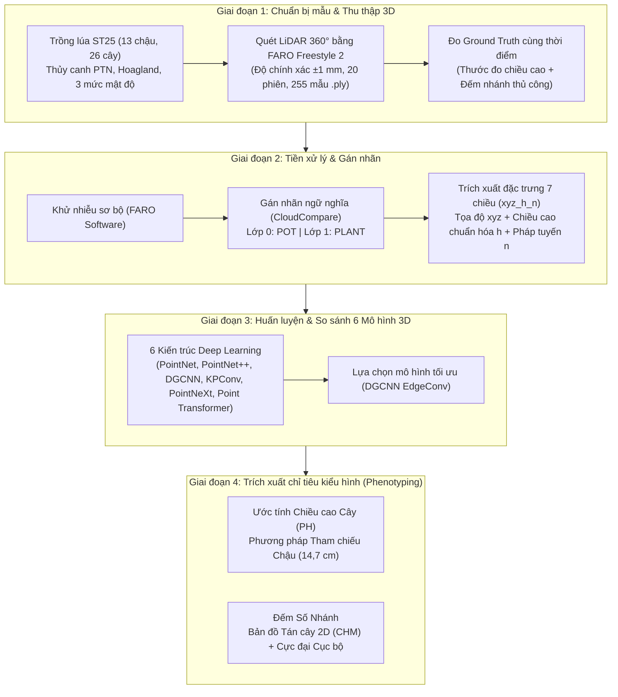
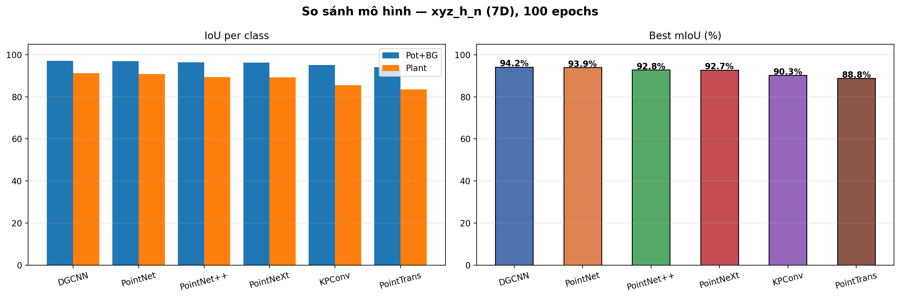
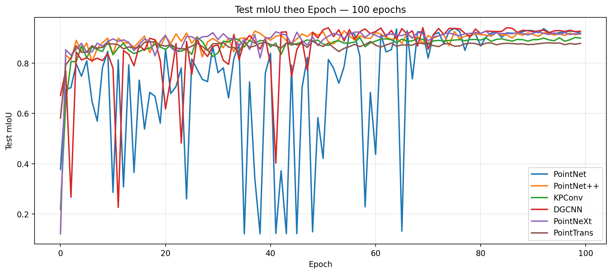
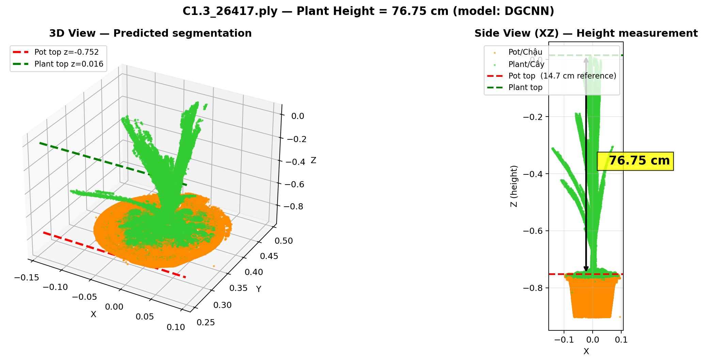
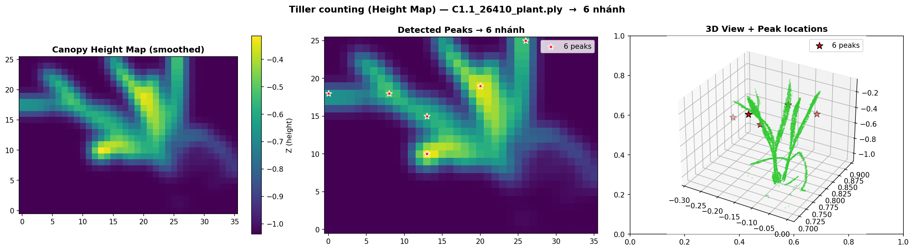
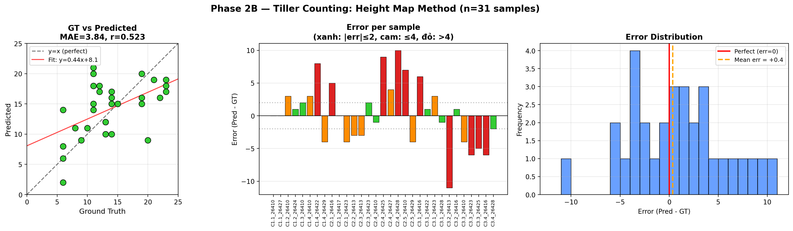
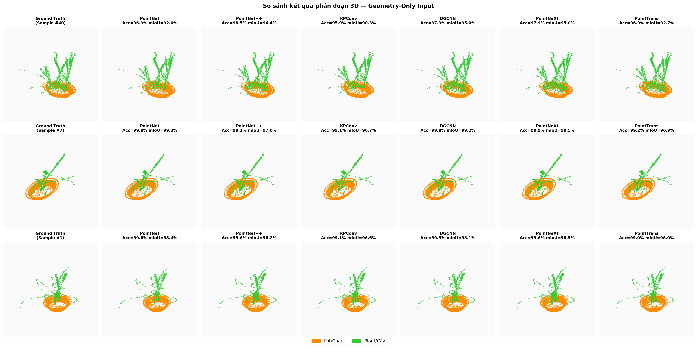
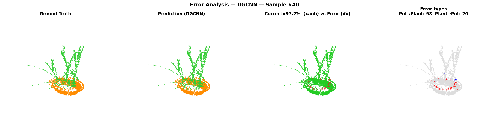
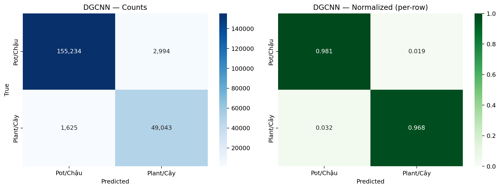

# 🌾 Nghiên Cứu Ứng Dụng Mô Hình Học Máy Theo Dõi Sinh Trưởng Cây Lúa
### *3D Point Cloud Semantic Segmentation & High-Throughput Phenotyping for Rice Growth Monitoring*

[](https://www.python.org/)
[](https://pytorch.org/)
[](https://www.danielgm.net/cc/)
[](#)
[](https://uet.vnu.edu.vn/)

---

## 🏛️ Thông Tin Đề Tài & Nhóm Nghiên Cứu

* **Cơ sở đào tạo:** Khoa Công nghệ Nông nghiệp (FAT) – Trường Đại học Công nghệ, Đại học Quốc gia Hà Nội (VNU - UET).
* **Loại hình:** Đồ án Tốt nghiệp Kỹ sư Công nghệ Nông nghiệp.
* **Sinh viên thực hiện:** **Nguyễn Sơn Tùng** (Lớp K67G-AT, MSSV: 22020115).
* **Giảng viên hướng dẫn:** 
  * **TS. Nguyễn Lê Khanh** (Khoa Công nghệ Nông nghiệp, VNU - UET)
  * **KS. Hà Quang Hưng** (Khoa Công nghệ Nông nghiệp, VNU - UET)

---

## 📌 Bối Cảnh & Mục Tiêu Nghiên Cứu

* **Bối cảnh:** Theo chuẩn IRRI-SES và TCVN 13381-1:2021, việc theo dõi kiểu hình cây lúa định kỳ đòi hỏi đo đạc trên 20 chỉ tiêu hình thái. Trong đó, **Chiều cao cây (PH)** và **Số nhánh (dảnh lúa)** là hai chỉ tiêu then chốt phản ánh sức sinh trưởng và cấu thành năng suất.
* **Hạn chế phương pháp truyền thống:** Phương pháp đo thủ công mang tính phá hủy mẫu (cắt, bẻ), sai số chủ quan, gián đoạn chuỗi thời gian và mất thông tin không gian 3 chiều của tán cây.
* **Mục tiêu đề tài:** Xây dựng quy trình tích hợp đầu cuối ứng dụng học sâu trên dữ liệu đám mây điểm 3D thu thập từ máy quét LiDAR cầm tay **FARO Freestyle 2**, phục vụ **phân đoạn ngữ nghĩa**, **đo chiều cao cây** và **đếm số nhánh** trên giống lúa **ST25**.

---

## 🔬 Quy Trình Nghiên Cứu (4 Giai Đoạn)



---

## 📊 Kết Quả Thực Nghiệm

### 1. So Sánh Hiệu Suất Phân Đoạn Ngữ Nghĩa (Tập Test 20%)
Cấu hình: GPU NVIDIA, PyTorch 2.x, Optimizer Adam (Cosine annealing, LR: $10^{-3}$), Batch size 16, 100 epochs + Early stopping:

| Xếp hạng | Mô hình | Đặc điểm kiến trúc | IoU Pot (%) | IoU Plant (%) | mIoU (%) |
| :---: | :--- | :--- | :---: | :---: | :---: |
| 🥇 **1** | **DGCNN (Best)** | **EdgeConv + k-NN graph động** | **97,3%** | **91,1%** | **94,20%** |
| 🥈 2 | PointNet | MLP toàn cục + Max-pooling | 96,8% | 91,0% | 93,90% |
| 🥉 3 | PointNet++ | Phân cấp trừu tượng cục bộ (SA + FP) | 96,4% | 89,3% | 92,80% |
| 4 | PointNeXt | Inverted residual MLP cải tiến scaling | 96,1% | 89,3% | 92,70% |
| 5 | KPConv | Tích chập điểm linh hoạt trên không gian liên tục | 95,1% | 85,5% | 90,30% |
| 6 | Point Transformer | Self-attention 3D cục bộ | 94,1% | 83,5% | 88,80% |

> **Nhận xét:** **DGCNN** đạt hiệu suất cao nhất nhờ cơ chế **EdgeConv** học quan hệ cạnh giữa các điểm trong không gian đặc trưng, rất phù hợp với cấu trúc dạng sợi, mảnh và đan xen của lá lúa. **Point Transformer** đạt kết quả thấp nhất do mật độ điểm tán cây ($5.000 - 20.000$ điểm) chưa đủ lớn để cơ chế self-attention phát huy tối đa ưu thế.

<p align="center">
  
  
</p>

---

### 2. Nghiên Cứu Loại Bỏ Thành Phần (Ablation Study trên DGCNN)
Đánh giá vai trò vật lý của từng thành phần đặc trưng đầu vào:

| Cấu hình đặc trưng | Số chiều | IoU Pot (%) | IoU Plant (%) | mIoU (%) | Cải tiến so với baseline |
| :--- | :---: | :---: | :---: | :---: | :---: |
| **$xyz$** (Baseline - Tọa độ thuần túy) | 3D | 95,1% | 86,4% | 90,70% | — |
| **$xyz + h$** (Thêm chiều cao chuẩn hóa) | 4D | 96,4% | 89,3% | 92,80% | **+2,10%** |
| **$xyz + h + n$** (Thêm vector pháp tuyến $k=20$) | 7D | **97,3%** | **91,1%** | **94,20%** | **+3,50%** |

* **Chiều cao chuẩn hóa ($h$):** Tạo ranh giới quyết định tự nhiên giữa Cây và Chậu theo trục $Z$.
* **Pháp tuyến bề mặt ($n$):** Giúp mô hình phân biệt rõ bề mặt phẳng cong đều của thành chậu với bề mặt lá lúa uốn lượn đa chiều ở vùng giao thoa mép chậu.

---

### 3. Ước Tính Chiều Cao Cây Lúa (Phương Pháp Tham Chiếu Chậu)
* **Nguyên lý:** Sử dụng chiều cao chậu thực tế ($H_{pot} = 14,7\text{ cm}$) làm chuẩn tỷ lệ để tính toán khoảng cách metric từ phân vị $99,5\%$ lớp Chậu tới phân vị $99,5\%$ lớp Cây.
* **Kết quả trên tập kiểm nghiệm ($n = 51$ mẫu):**

$$\text{RRMSE} = 5,49\% \quad (<\text{Ngưỡng } 10\% \text{ của chuẩn IRRI-SES} \rightarrow \mathbf{ĐẠT\ TIÊU\ CHUẨN})$$

| Chỉ số đánh giá | Giá trị | Ý nghĩa thực tế |
| :--- | :---: | :--- |
| **MAE** | **2,85 cm** | Sai số tuyệt đối trung bình mỗi lần đo chỉ ~2,8 cm |
| **RMSE** | **4,23 cm** | Sai số lớn nhất điển hình ~4 cm |
| **RRMSE** | **5,49%** | Đạt chuẩn quốc tế IRRI cho quan trắc kiểu hình lúa |
| **$R^2$** | **0,95** | Mô hình giải thích được **95%** biến thiên thực tế |
| **Bias** | -2,28 cm | Có xu hướng ước lượng thấp nhẹ (có thể bù bằng hệ số cố định) |

* **Tính ổn định:** $76,4\%$ mẫu đạt sai số tuyệt đối $< 5\text{ cm}$. Với cây trưởng thành ($\ge 60\text{ cm}$), $MAE$ rất ổn định ở mức $2,50 - 2,54\text{ cm}$.

<p align="center">
  
</p>

---

### 4. Đếm Số Nhánh Cây Lúa (Bản Đồ Tán Cây CHM + Cực Đại Cục Bộ)
* **Nguyên lý:** Chiếu điểm 3D của lớp Cây xuống lưới 2D ($35 \times 25$, lấy $Z_{max}$ mỗi ô) $\rightarrow$ Làm mịn Gaussian ($\sigma = 1,5$) để khử nhiễu $\rightarrow$ Dò cực đại cục bộ (Local Maxima).
* **Kết quả tổng thể ($n = 31$ mẫu test):**
  * $MAE$: **3,84 nhánh**
  * Hệ số tương quan Pearson: $r = 0,523$ (mô hình nắm bắt đúng xu hướng ít/nhiều nhánh).
* **Phân tích theo từng nhóm số nhánh:**
  * **Nhóm 14–19 nhánh:** Vùng hiệu suất tối ưu nhất, đạt $MAE = \mathbf{2,25\text{ nhánh}}$ ($r = 0,45$).
  * **Nhóm $\ge 20$ nhánh:** Sai số tăng lên ($MAE = 5,67$) do hiện tượng tán lá dày che khuất lẫn nhau trong phép chiếu 2D.

<p align="center">
  
  
</p>

---

## 🖼️ Trực Quan Hóa Kết Quả

| Phân đoạn GT vs Dự đoán (DGCNN) | Phân tích sai số phân đoạn | Ma trận nhầm lẫn (Confusion Matrix) |
| :---: | :---: | :---: |
|  |  |  |

---

## 📁 Cấu Trúc Thư Mục Repository

```text
3D-Rice-PointCloud-Phenotyping/
├── README.md                                       # Tài liệu tổng quan đề tài & kết quả nghiên cứu
├── requirements.txt                                # Thư viện phụ thuộc (PyTorch, Open3D, plyfile,...)
├── .gitignore                                      # Bộ lọc file nén, dataset nặng
│
├── assets/                                         # Biểu đồ và hình ảnh thực nghiệm
│   ├── gt_vs_pred.png
│   ├── miou_curves.png
│   ├── model_comparison.png
│   ├── confusion_DGCNN.png
│   ├── error_analysis_DGCNN.png
│   ├── phase2_height_measurement.png
│   └── phase2b_tiller_counting.png
│
├── checkpoints/                                    # Trọng số các mô hình đã huấn luyện
│   ├── dg_best.pth                                 # Weights mô hình DGCNN tối ưu (mIoU 94.20%)
│   ├── pointnext_best.pth
│   ├── pp_best.pth
│   ├── kp_best.pth
│   ├── pt_best.pth
│   ├── pn_best.pth
│   └── ablation/                                   # Checkpoints thực nghiệm loại bỏ đặc trưng
│       ├── pp_xyz.pth
│       ├── pp_xyz_h.pth
│       └── pp_xyz_h_n.pth
│
├── notebooks/                                      # Jupyter Notebook toàn bộ pipeline
│   └── rice_3d_segmentation_phenotyping.ipynb
│
├── results/                                        # Bảng số liệu đối chứng đo đạc thực tế
│   ├── phase2_heights.csv                          # Chiều cao thực vs ước lượng
│   ├── phase2_heights_result.xlsx                  # Báo cáo thống kê Excel chi tiết
│   └── phase2b_tillers.csv                         # Dữ liệu đếm nhánh đối chứng
│
└── data/                                           # Quản lý bộ dữ liệu đám mây điểm 3D
    └── README.md                                   # Hướng dẫn chi tiết tải 255 mẫu từ Kaggle
```

---

## 💡 Đóng Góp & Định Hướng Phát Triển

### Đóng Góp Của Đề Tài:
1. Xây dựng thành công **quy trình tích hợp đầu cuối (End-to-End Pipeline)** từ khâu quét LiDAR thực tế đến trích xuất kiểu hình tự động không phá mẫu.
2. Chứng minh học sâu 3D hoàn toàn **thay thế được phương pháp đo tay chiều cao cây** với $RRMSE = 5,49\%$ (đạt tiêu chuẩn quốc tế IRRI-SES $< 10\%$).
3. Đóng góp bộ dữ liệu **255 mẫu đám mây điểm 3D giống lúa ST25** được gán nhãn chuẩn ngữ nghĩa, làm tiền đề cho các nghiên cứu tiếp theo.

### Hạn Chế & Định Hướng:
* **Hạn chế:** Toàn bộ thí nghiệm thực hiện trong phòng thí nghiệm (PTN); phương pháp CHM 2D bị giảm độ chính xác khi tán lá quá dày ($\ge 20$ nhánh).
* **Định hướng:**
  * *Ngắn hạn:* Mở rộng thực nghiệm ngoài đồng ruộng và nghiên cứu mô hình Deep Learning 3D trực tiếp (thay vì chiếu 2D) để đếm nhánh.
  * *Trung hạn:* Xây dựng chuỗi thời gian sinh trưởng đầy đủ từ giai đoạn mạ đến thu hoạch trên nhiều giống lúa khác nhau.
